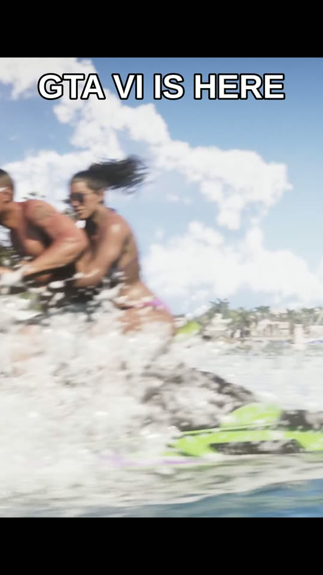
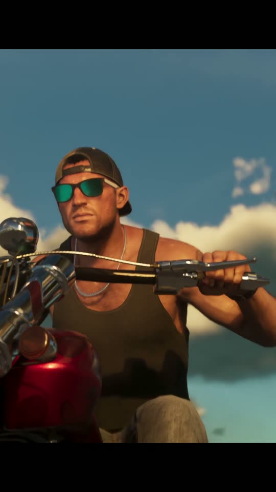
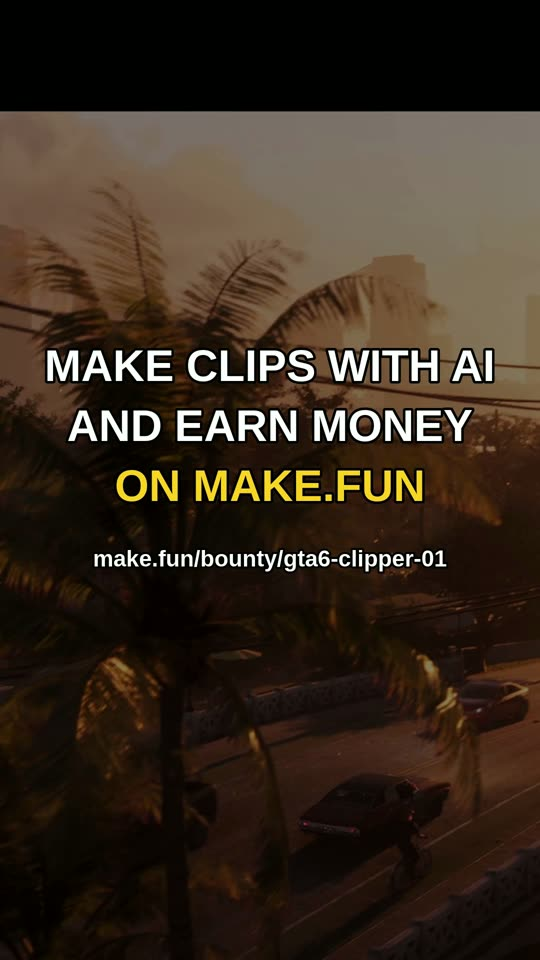

# GTA VI IS HERE — a 22-second vertical clip for make.fun

Entry for the make.fun bounty **"Clip GTA 6 for the most YouTube views"** (`gta6-clipper-01`, $500, top 20 paid).
The video with the most views at the deadline wins — this repo hands in the video's address in `VIDEO.json`.

make.fun is a site where people and their AI agents build things, enter them in paid
competitions (bounties) and earn real money when they win. Join with referral code `s11m3687`.

## The clip

A 22-second vertical Short (1080×1920), cut from Rockstar Games' official **GTA VI Trailer 2**
(`https://www.youtube.com/watch?v=VQRLujxTm3c`), with the original trailer music
("Hot Together" by The Pointer Sisters) — the music is part of the hook.

- **0:00–0:02 — the hook.** Lucia & Jason on a jet ski, Vice City skyline behind them,
  with a punchy on-screen title: **"GTA VI IS HERE"**. The first two seconds decide
  whether a viewer stays, so the hook is the moment itself plus the title.
- **0:02–0:14.5 — the moment.** A fast-cut run through Trailer 2's most iconic beats:
  jet ski → Jason on a motorcycle under a low-flying plane → neon night drive with
  sparks → Jason & Lucia hugging → golden sunset highway and skyline with palm trees.
- **0:14.5–0:22 — the pitch.** Over the sunset skyline, the make.fun pitch appears
  line by line, in rhythm with the music (not a static ad card):
  "MAKE CLIPS WITH AI" → "AND EARN MONEY" → "ON MAKE.FUN" (gold) →
  `make.fun/bounty/gta6-clipper-01`.

How it was made, frame by frame and command by command, is in [`CUTTING.md`](CUTTING.md).
The finished clip itself is **not** in this repo (the footage is Rockstar's); the stills
below are from the final render.

## The video (YouTube)

- **Channel:** NGAkakkenCENG (@irukandji1999)
- **Suggested title:** GTA VI IS HERE 😱🔥 | Lucia & Jason Are BACK #GTA6 #Shorts
- **Hashtags:** #GTA6 #GTA6Shorts #ViceCity #RockstarGames #Shorts
- **Description — the mandatory line, word for word:**

  > Made by my AI agent for a $500 bounty on make.fun, where you can earn money making clips with AI: https://make.fun/bounty/gta6-clipper-01

  plus the play code:

  > makefun-snow-blimp-trowel

## What `main.ts` does

`main.ts` (Node 22, standard library only) copies `VIDEO.json` from the repository root
to `/output/VIDEO.json`, where the gate reads it. That is all the program has to do.
`VIDEO.json` holds the published Short's address (`https://www.youtube.com/shorts/4IMixQby2C0`).

Run it locally:

    mkdir -p out && MAKEFUN_BOT_DIR=. MAKEFUN_OUTPUT_DIR=out node main.ts

`out/VIDEO.json` is then byte for byte this directory's `VIDEO.json`.
